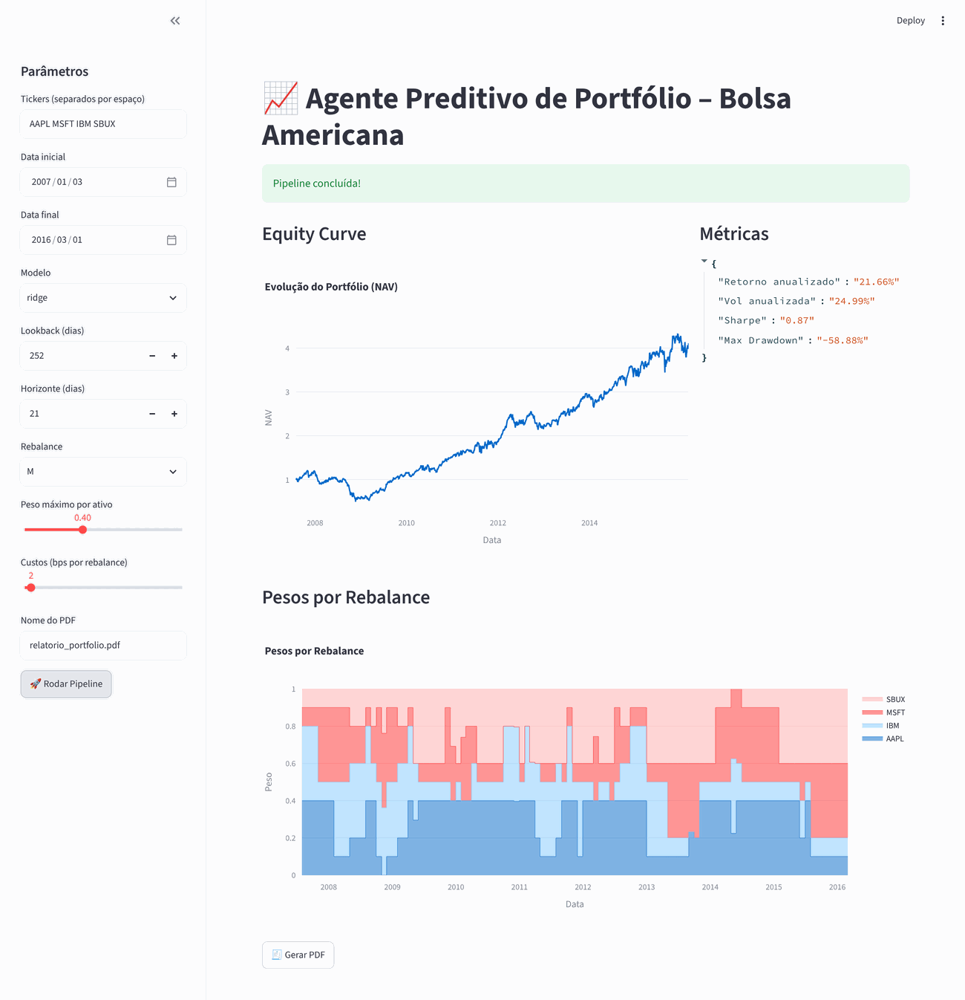
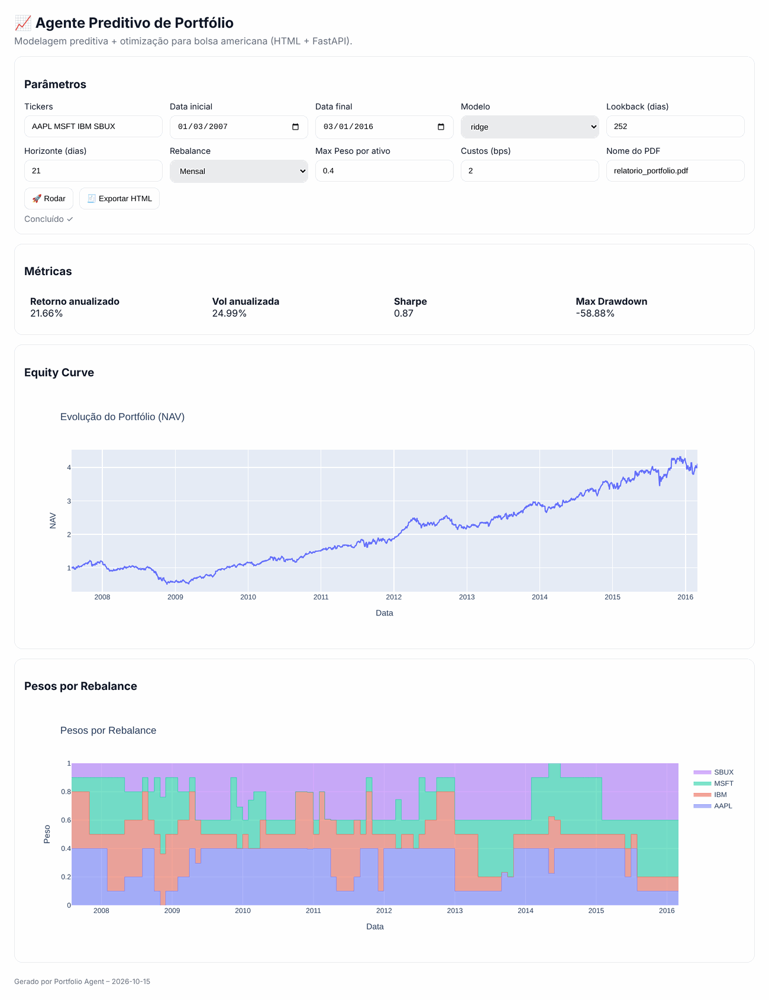
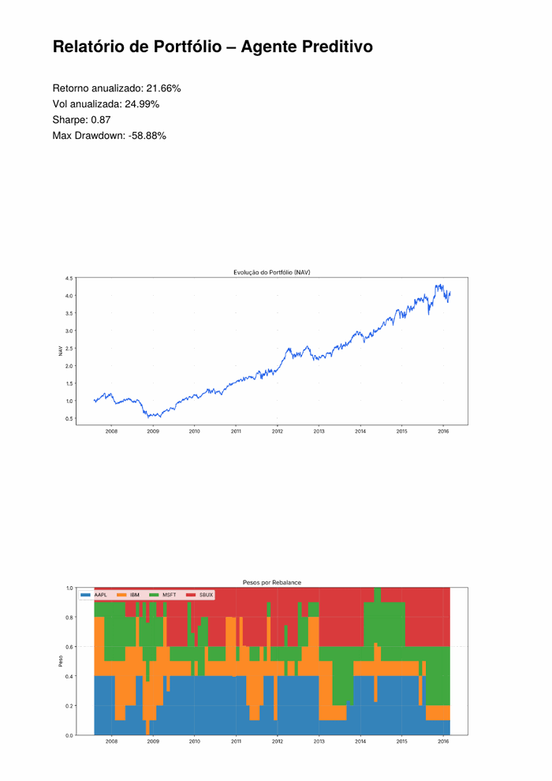

# Trading & Portfolio Notebooks

A collection of Jupyter notebooks for **technical analysis, options and crypto**, plus a full **predictive portfolio agent** (ML forecasts, mean-variance allocation, backtest, reports) with three interfaces: a Streamlit dashboard, a FastAPI + HTML web app and a CLI.

> ⚠️ Educational project. Not financial advice. Use at your own risk.


<sub>Screenshot from a real run on daily closes of AAPL, MSFT, IBM and SBUX, Jan 2007 – Mar 2016. Prices come from Plotly's public `stockdata.csv` dataset; the app normally downloads them with yfinance. Ridge model, monthly rebalance, 40% cap per asset, 2 bps costs.</sub>

---

## 1. `portfolio_agent/`: predictive portfolio agent

### What it does
```
yfinance prices ─► features ─► ML forecast ─► mean-variance weights ─► backtest ─► metrics + charts + PDF/HTML report
```
| Step | File | Details |
|---|---|---|
| Data | `data.py` | Daily prices from Yahoo Finance (`yfinance`), cached locally as parquet |
| Features | `features.py` | 21- and 63-day returns, 126-day momentum, 21-day volatility |
| Forecast | `models.py` | **Ridge** or **Random Forest** trained on a rolling window (default 252 days) to predict the next-21-day return, tilted by each stock's relative momentum |
| Allocation | `optimize.py` | Mean-variance weights (Σ⁻¹·μ), long-only, with a **max weight per asset** |
| Backtest | `backtest.py` | Monthly or weekly rebalance, transaction costs in bps, daily NAV |
| Output | `pipeline.py`, `report.py` | Annualised return and volatility, Sharpe, max drawdown, equity curve, weights over time, PDF and HTML reports |

### Three ways to use it

**Streamlit dashboard** (shown above). Set the parameters in the sidebar, click *Rodar Pipeline*, then *Gerar PDF*.

**Web app (FastAPI + HTML).** The same pipeline in a plain HTML page. *Exportar HTML* downloads a self-contained interactive report.



**CLI.** Prints the metrics and writes a PDF report:



```bash
python -m agent.cli --tickers AAPL MSFT IBM SBUX \
  --start 2007-01-03 --end 2016-03-01 --max_weight 0.4
# Métricas: {'Retorno anualizado': '21.66%', 'Vol anualizada': '24.99%',
#            'Sharpe': '0.87', 'Max Drawdown': '-58.88%'}
# PDF gerado em: report.pdf
```
The PDF report is shown on the right.

<br clear="right"/>

### Quick start
```bash
cd portfolio_agent
pip install -r requirements.txt
pip install -e .                                   # makes the `agent` package importable

streamlit run app_streamlit/app.py                 # dashboard  → http://localhost:8501
uvicorn agent.api_fastapi:app --reload             # web app    → http://localhost:8000
python -m agent.cli --tickers AAPL MSFT GOOGL --start 2018-01-01 --end 2025-01-01
pytest -q                                          # tests (run offline)
```
Run `uvicorn` from inside `portfolio_agent/` so it can find the `web/` folder. More details (in Portuguese) are in [`portfolio_agent/README.md`](portfolio_agent/README.md).

> The backtest is a simple research tool. Results depend heavily on the period and tickers you choose, and past performance says nothing about the future.

---

## 2. Notebooks
All notebooks download data at run time, mainly from Yahoo Finance via `yfinance`. Most comments are in Portuguese.

| Notebook | What it does |
|---|---|
| `black_scholes_stock_analysis(7).ipynb` | Stock chart, then every Black-Scholes input (spot, volatility, rate), then option prices and Greeks |
| `Caderno_Trading_AllInOne_FIX5_Decisoes.ipynb` | All-in-one notebook for LULU, GAP and ANF: MACD, RSI, ADX/ATR, ATR position sizing and a **buy/sell decision tree** |
| `Caderno_Trading_LULU_GAP_ANF_ADX_ATR_Alarmes_Notificacoes.ipynb` | The same analysis plus **alerts** by e-mail (SMTP) or webhook (Slack, Discord, Teams) |
| `sp500_stock_analyzer MACD 2.ipynb` | S&P 500 screener with MACD signals |
| `crypto_trading_XRP_cmc_fallback_binance_v3_1h.ipynb` | XRP on 4 h, 1 h, 8 h and daily timeframes with MACD, RSI and EMA-21. CoinMarketCap data with a Binance fallback |
| `stock_trading_yahoo_LULU_periods.ipynb` | LULU across several periods and timeframes |
| `Portfolio_Agent_Notebook_Fixed.ipynb` | Notebook version of the portfolio agent |
| `PATCH_FIX_mplfinance_candles.ipynb` | Fix for candlestick plotting with `mplfinance` |
| `Strings.ipynb` | Python strings tutorial (study notes) |

Older versions (FIX4, MACD v1, `sp500_stock_analyzer(8)`, `Portfolio_Agent_Notebook`) are kept for reference.

```bash
pip install pandas numpy yfinance matplotlib mplfinance plotly requests jupyter
jupyter notebook
```

## API keys
This repository contains **no API keys**. Every key is **optional**: CoinMarketCap, SMTP e-mail and the webhook URL for alerts. Copy `.env.example` to `.env` and add **your own** values. `.env` is in `.gitignore`, so it is never committed.

## Tech
Python · pandas · NumPy · scikit-learn · yfinance · Plotly · matplotlib · mplfinance · Streamlit · FastAPI · ReportLab · pytest

**Author:** Rodrigo Chemite Barbosa · [github.com/ch3m1bb5](https://github.com/ch3m1bb5)
